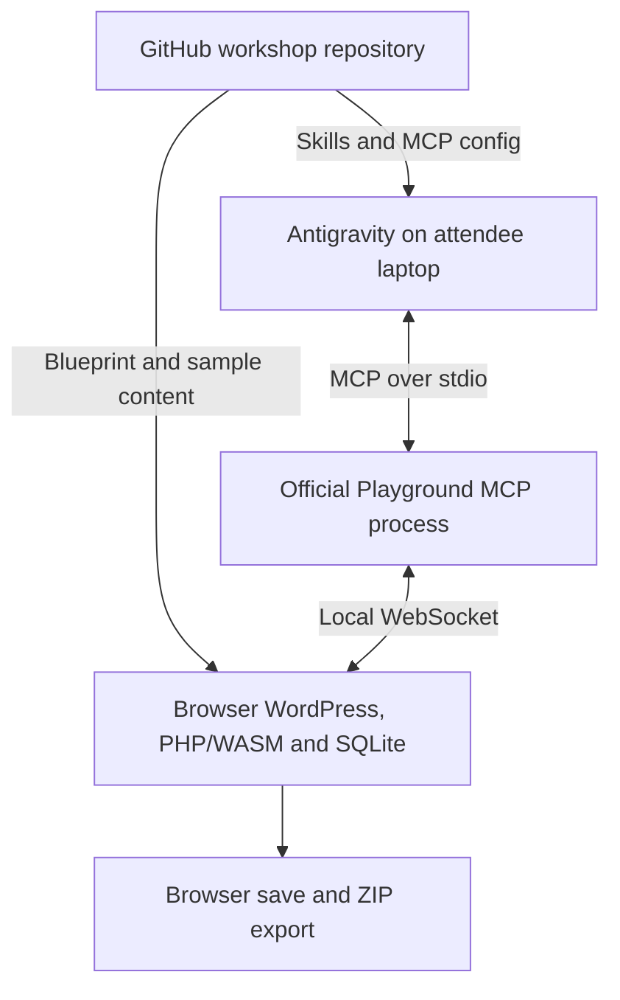

# WordPress Playground for the Agent Skills workshop

- `Tease:` The browser-to-MCP bridge already exists.
- `Lede:` Use local Antigravity, official `@wp-playground/mcp@3.1.60`, and browser WordPress Playground. Put the starting site, sample brief, and skills in the workshop GitHub repository.
- `Why it matters:` Attendees can operate real WordPress through MCP without Docker, a separate PHP installation, or a MySQL server. Their results remain visible in a browser.
- `Go deeper:` Add an AI Studio or Firebase launcher after the local MCP demonstration works. A cloud agent reaching an attendee's browser is a separate integration.

Research date: October 24, 2026. This preserves the initial feasibility research, with the implementation decisions below added after locating the meetup monorepo. No Antigravity-to-browser runtime rehearsal is claimed.

## Implementation follow-up

The repository is now identified as `techlahoma/techlahoma-google-apps-starter`. The app and handoff live under [`apps/wordpress-playground`](../../apps/wordpress-playground/README.md). The current [spec](../wordpress-workshop/SPEC.md), [plan](../plans/wordpress-playground-workshop-2026-10-24.md), and [browser security research](wordpress-playground-browser-bridge-2026-10-24.md) govern implementation.

- Latest observed remains **3.1.60 (October 20)**. The runnable scaffold pins **3.1.58 (October 12)** to respect the repository's seven-day release buffer. Both expose the required browser bridge; this is a stability-policy choice, not a claim that 3.1.60 is defective.
- The exported `startMcpBridge` API accepts a small site adapter. The hosted wrapper can run this official bridge directly; a new transport is unnecessary.
- The wrapper uses the official hosted `/remote.html` runtime. Pinning the client does not pin that separately deployed runtime.
- The wrapper's first version is explicitly temporary. ZIP export/import provides recovery. `playground_save_in_browser` reports unsupported rather than pretending to persist the site. Instructions below about browser saving apply to the canonical Playground website.
- AI Studio receives a standalone export because the monorepo root starts another app. Firebase Hosting uses the existing app-scoped deployment workflow. Deployment and real-browser rehearsal remain distinct from source/build verification.

Pinned implementation evidence: [3.1.58 release](https://github.com/WordPress/wordpress-playground/releases/tag/v3.1.58), [bridge interface](https://github.com/WordPress/wordpress-playground/blob/v3.1.58/packages/playground/mcp/src/bridge-client.ts), and [client export](https://github.com/WordPress/wordpress-playground/blob/v3.1.58/packages/playground/mcp/src/client.ts).

## Recommendation and evidence

The project from the early browser demos is WordPress Playground. It runs PHP compiled to WebAssembly and uses SQLite for WordPress. The official browser MCP bridge was announced March 17, 2026. It connects a local stdio MCP client to the browser through a localhost WebSocket. That is the missing connection in the original proposal, and WordPress already maintains it. [S1, S3]

Latest release observed: Playground v3.1.60, released October 20, 2026. The exact release-tag MCP manifest also reports version 3.1.60. This is the current official release recommendation for a workshop, not a claim that Playground is a general replacement for production PHP/MySQL hosting. [S2, S4]

The strongest implementation evidence is the pinned upstream source. `playground_request` supports WordPress REST calls and applies the logged-in session's REST nonce. Its tests cover authenticated post create/read/update/delete, object request bodies, and denial of logged-out writes. We inspected those tests; we did not run them. [S5, S6]

### What changed since the early demos

| Development | Why it matters here | Evidence |
| --- | --- | --- |
| Official browser MCP, March 17, 2026 | A custom WASM transport adapter is unnecessary for the local route | S1 |
| Official Blueprint skill, April 2, 2026 | The workshop can use an existing WordPress skill before attendees make one | S10 |
| Playground skill refresh, July 28, 2026 | Guidance separates browser, Blueprint, and CLI workflows | S11 |
| WebMCP integration, September 5, 2026 | A possible browser-native bonus demo, subject to compatible client support | S19 |
| v3.1.60, October 20, 2026 | Current version to pin and rehearse | S2, S4 |

Current alternatives require care. `wp-now` is deprecated in favor of Playground CLI `start`. WordPress Studio 1.24.0 removed its WebAssembly Sandbox runtime and now uses native PHP. Older advice calling Studio the desktop WASM option is stale. [S13, S14]

## Recommended connection



The PHP runtime lives in the browser; the small Node process carries MCP messages. This removes Docker and the traditional WordPress server stack, but the complete workflow still needs Antigravity and compatible Node/npm. [S1, S4]

A URL that looks like a WordPress REST endpoint inside Playground does not turn that browser's site into a public HTTP server. The bridge calls into the active Playground instance. The browser must run on the same machine as this local bridge. A generic remote WordPress MCP server cannot reach it merely by being given the apparent URL. [S1, S3]

### Antigravity configuration

Current Google documentation supports workspace `.agents/mcp_config.json` and global `~/.gemini/config/mcp_config.json`. In the IDE, the documented route is MCP Servers, Manage MCP Servers, View raw config. Use the workspace file for the workshop. [S7]

```json
{
  "mcpServers": {
    "wordpress-playground": {
      "command": "npx",
      "args": ["-y", "@wp-playground/mcp@3.1.60"]
    }
  }
}
```

Prepare Node >=24.18.0 and npm >=11.16.0. Those are the requirements in the exact v3.1.60 MCP manifest. Older CLI documentation and the README's development section mention older Node versions. The September engine update and pinned manifest are the stronger evidence for current setup. [S4, S8]

Use the MCP's `playground_get_website_url` result. It contains the current bridge port. A generic bookmarked Playground URL or a port copied from the instructor is not sufficient for each student's local connection. [S3, S9]

### Connection and posting sequence

1. Open the repository in Antigravity and enable the configured MCP server.
2. Ask for the Playground website URL and open it in the same laptop's browser.
3. Load the workshop Blueprint, either through the Dock's New / Blueprint URL flow or through the configured launch URL described below.
4. Discover the correct site with `playground_list_sites` and save it with `playground_save_in_browser`.
5. Create a WordPress draft through `playground_request`.
6. Read the draft back, verify its content and status, and open its editor.

Example arguments for the content request, after obtaining a real `siteId`: [S5, S6]

```json
{
  "siteId": "<discovered-site-id>",
  "url": "/wp-json/wp/v2/posts",
  "method": "POST",
  "body": {
    "title": "Our workshop draft",
    "content": "<!-- wp:paragraph --><p>Prepared from the supplied event brief.</p><!-- /wp:paragraph -->",
    "status": "draft"
  }
}
```

No Application Password or WordPress MCP Adapter plugin is needed for this browser route. The request uses the WordPress session in that sandbox. The more general `playground_execute_php` exists, but ordinary post work should use REST. [S3, S5]

## GitHub repository proposal

The initial research proposed the structure below. The located monorepo uses the scoped app layout linked in the implementation follow-up; this table is the original conceptual proposal.

| Path | Purpose |
| --- | --- |
| `README.md` | Prerequisites, launch instructions, prompts, expected results, and save/export guidance |
| `.agents/mcp_config.json` | The pinned local MCP configuration |
| `.agents/skills/wp-playground/` | Reviewed copy of the official Playground skill and its referenced resources |
| `.agents/skills/blueprint/` | Reviewed copy of the official Blueprint skill and references |
| `.agents/skills/event-publisher/` | The small skill attendees create or modify |
| `blueprints/starter.json` | WordPress/PHP versions, login, starter theme, and seeded content |
| `examples/event-brief.md` | Identical input for both comparison runs |
| `examples/publishing-rules.md` | The business/editorial requirements available to both runs |
| `examples/expected-result.md` | Observable criteria for checking the result |
| `.github/workflows/check-blueprint.yml` | Optional Blueprint validation and one content check in CI |
| `web/` | Optional static workshop landing page |

Antigravity discovers project skills under `.agents/skills/<name>/SKILL.md`. Keep the skill's referenced resources with it. The official WordPress collection includes `wp-playground` and `blueprint`. Its documented installation path uses `npx skills add WordPress/agent-skills`; select the relevant skills and Antigravity. Commit the reviewed files or pin the source revision before the workshop so attendee installation does not silently change the exercise. [S10, S11, S12, S20]

A public starter link can use:

```text
https://playground.wordpress.net/?blueprint-url=https://raw.githubusercontent.com/OWNER/REPO/COMMIT/blueprints/starter.json
```

`OWNER`, `REPO`, and `COMMIT` are placeholders. The source must return public JSON or a Blueprint ZIP, with suitable CORS headers. GitHub's HTML `blob` page will not work. Pin the commit for the workshop. A private repository needs a separately published public starter or a local import; do not place credentials in this URL. [S15]

### Combine the starter with the MCP connection

The exact v3.1.60 code accepts a `--url=` base URL and preserves existing query parameters when adding `mcp-port`. After publishing the starter, append a configuration argument shaped like this: [S9]

```text
--url=https://playground.wordpress.net/?blueprint-url=https://raw.githubusercontent.com/OWNER/REPO/COMMIT/blueprints/starter.json
```

Still open the exact URL returned by the MCP server, because the port is chosen for that process. This combined launch mechanism is verified in source and still needs the rehearsal below.

### Reproducibility and persistence

A Blueprint recreates the starting site. Each attendee gets their own browser state. A shared starter link does not create a single shared blog, and posting in one attendee's sandbox does not update the GitHub starter.

Current Playground autosaves up to five recent sites where storage is available. Explicitly save the workshop site and export a ZIP at the end. Temporary sites disappear on tab closure or browser refresh; browser storage can also disappear through profile changes, eviction, or clearing site data. [S16]

Pinning the npm MCP/client version does not freeze the live website at `playground.wordpress.net`. Pin WordPress/PHP and the Blueprint, and rehearse against the hosted site. Fully freezing the runtime requires self-hosted assets or a pinned CLI runtime, which is extra work for this workshop.

Optional CI should check that the Blueprint validates, boots, and produces its intended initial content. A public PR-preview button is useful only if attendees work on plugins or themes. The main post-publishing demo does not need that workflow.

## Demo ideas

### 1. Turn a rough event brief into an actual WordPress draft

This is my first choice. Supply a short synthetic Google Dev Group event brief and an editorial-rules file. Include one explicit gap, such as a venue marked TBD.

The custom skill tells the agent to discover the target site, preserve supplied facts, handle the missing field, use editable WordPress blocks, assign the intended category, create a draft, read it back, and open the result. The useful output is visible in WordPress.

Run the same request twice, in fresh conversations and restored starter sites. Both runs keep the same model, MCP tools, brief, publishing rules, and allowed web access. Only the skill changes. This tests whether the packaged procedure improves execution; withholding essential business rules from the first run would test missing information instead.

Check actual saved title, category, status, date, links, editable structure, and treatment of the missing venue. Do not promise that the baseline will fail. If both runs succeed, compare corrections, tool calls, and verification behavior.

Suggested request:

> Turn examples/event-brief.md into a WordPress draft using examples/publishing-rules.md. Open the result for inspection.

### 2. Generate a complete browser WordPress starting site from a sentence

Use the official `blueprint` skill to request a small event site with a homepage, sample posts, categories, and a selected theme. The result is a JSON recipe and a working launch link. Invite someone to change the theme or content requirements and regenerate it.

The April skill article documents concrete errors that instructions address, including obsolete property names, missing Git ref types, and missing WordPress bootstrapping in PHP snippets. These are plausible evaluation targets, not guaranteed baseline failures. [S10]

A July maintainer comparison reports better guidance scores for the refreshed Playground skill. Its cleaner content-only result was 18/18 with the new skill and 11/18 without it. This was four scenarios, one run per prompt, and guidance grading, not live execution. The Blueprint-only scenario did not differentiate answer quality. Do not present these numbers as a general measured skill uplift. [S11]

### 3. Add a small plugin and show the behavior immediately

For a developer-heavy group, ask the agent to add a tiny workshop-specific plugin, such as a reusable event-details block or a content-quality check, then operate it in the sandbox. Keep this bounded and use one rehearsed example. The MCP already exposes file operations, PHP execution, and browser navigation. [S3]

A visual refresh using a design skill is also possible, but choose a WordPress-aware implementation path. A frontend design skill alone does not establish knowledge of WordPress templates or valid block serialization.

The teaching distinction is straightforward: Playground supplies the running application, MCP supplies actions, and the skill supplies a repeatable procedure. A skill can provide current instructions at inference time; it does not change the model's training cutoff.

## Where AI Studio and Firebase fit

| Option | Current evidence | Recommendation |
| --- | --- | --- |
| Local Antigravity plus official browser MCP | Documented stdio support, bridge source, post CRUD tests | Main workshop path |
| AI Studio Build creates a launcher and deploys to Cloud Run | GitHub import/two-way sync and Cloud Run deployment are documented | Optional presentation layer |
| Firebase Hosting serves a static launcher | Static hosting, HTTPS, and GitHub integration are documented | Simple Google-hosted landing page |
| AI Studio Playground Agents loads the repo's skills | GitHub sources and `.agents/skills` discovery are documented | Good separate skills demo; laptop WordPress connectivity needs more work |
| Cloud Node/PHP-WASM WordPress with a remote MCP endpoint | Components are plausible, but this combined deployment was not tested | Defer as a separate integration |

AI Studio has two different relevant experiences. Build mode can import a repository, synchronize it in both directions, and deploy an app to Cloud Run. The Agents playground can mount GitHub files and load skills in a managed Linux environment. Those are distinct capabilities. [S17, S18]

The managed Antigravity agent documents remote MCP over Streamable HTTP. Its `localhost` is Google's environment, not the attendee's laptop. Connecting it to the browser WordPress instance therefore needs an additional reachable relay or a different server-side runtime. This is an architectural inference from the documented environment and transport. [S21]

For this week, make the optional launcher page show the instructions, starter link, and demo rubric, then open the canonical Playground UI in its own tab. A plain `remote.html` iframe is not automatically the complete Playground website's MCP integration. A bespoke embedded application needs explicit integration work. [S3]

Hosting that launcher on Cloud Run or Firebase does not publish the attendees' private WordPress databases. A truly shared writable WordPress installation is another requirement. If running Node/PHP-WASM on Cloud Run, its default filesystem does not persist when an instance stops, and autoscaling creates multiple instances. Design database and file persistence before calling that shared production hosting. [S22, S23]

## When to use the conventional WordPress MCP Adapter

`WordPress/mcp-adapter` exposes registered WordPress Abilities through MCP. It is a separate integration from `@wp-playground/mcp`. Installing the adapter alone does not guarantee a create-post action; a plugin must expose the required abilities. [S24, S25]

If teaching that production-style integration is the goal, run Playground under Node with its real local HTTP endpoint:

```bash
npx @wp-playground/cli@3.1.60 start --blueprint=./blueprints/starter.json
```

Then configure the adapter, required content abilities, and authentication. `start` persists a site per working directory; `server` is the more manual mode and is temporary without appropriate mounts. This still avoids Docker and uses the WASM runtime, but adds setup compared with the official browser bridge. [S13, S25]

WebMCP is another distinct path. It exposes tools through a compatible browser session and can avoid the Node intermediary, but remains a draft with client-dependent support. Do not infer Antigravity or AI Studio WebMCP support from ordinary MCP support. Treat it as an optional future demo. [S19]

## Smallest useful rehearsal

Run on the actual presentation laptop and intended browser:

1. Verify the pinned package starts through Antigravity with the declared Node/npm versions.
2. Open the generated bridge URL and load the starter Blueprint.
3. Confirm the expected site appears in `playground_list_sites` and save it.
4. Create one draft through REST, read it back, and open the editor.
5. Reload and verify that the draft survives.
6. Reset the starting state, run the comparison in fresh conversations, and export a backup.

Pre-download the package and open the starter before the workshop. Keep the initial theme/plugins small. These checks target the actual integration risks, not a broad WordPress compatibility audit.

## Evidence limits

Documentation and pinned source establish component capabilities. They do not establish that the full Antigravity/browser combination has been rehearsed on the presentation laptop. No independent live latency or compatibility measurements were collected in this research. The recommendation relies on official documentation, source, and tests. The accompanying verification record distinguishes tests actually run from proposed acceptance checks.

## Source links

- S1. [Official Playground MCP announcement, March 17, 2026](https://make.wordpress.org/playground/2026/03/17/connect-ai-coding-agents-to-wordpress-playground-with-mcp/).
- S2. [Playground releases, v3.1.60 dated October 20, 2026](https://github.com/WordPress/wordpress-playground/releases).
- S3. [MCP README at v3.1.60](https://github.com/WordPress/wordpress-playground/blob/v3.1.60/packages/playground/mcp/README.md).
- S4. [MCP package manifest at v3.1.60](https://github.com/WordPress/wordpress-playground/blob/v3.1.60/packages/playground/mcp/package.json).
- S5. [MCP tool definitions at v3.1.60](https://github.com/WordPress/wordpress-playground/blob/v3.1.60/packages/playground/mcp/src/tools/tool-definitions.ts).
- S6. [Upstream MCP end-to-end tests at v3.1.60](https://github.com/WordPress/wordpress-playground/blob/v3.1.60/packages/playground/mcp/tests/e2e/mcp-tools.spec.ts).
- S7. [Antigravity MCP configuration](https://antigravity.google/docs/mcp/).
- S8. [Node/npm requirement update, merged September 16, 2026](https://github.com/WordPress/wordpress-playground/pull/4322).
- S9. [MCP URL argument handling at v3.1.60](https://github.com/WordPress/wordpress-playground/blob/v3.1.60/packages/playground/mcp/src/index.ts), together with the `playgroundUrl` function in S5.
- S10. [Official Blueprint skill introduction, April 2, 2026](https://make.wordpress.org/playground/2026/04/02/teach-your-coding-agent-to-write-wordpress-playground-blueprints/).
- S11. [Playground skill update and benchmark limitations, July 28, 2026](https://make.wordpress.org/playground/2026/07/28/one-playground-three-workflows-consistent-agent-guidance-across-surfaces/).
- S12. [WordPress agent skills](https://github.com/WordPress/agent-skills).
- S13. [Playground CLI, including wp-now migration](https://developer.wordpress.org/playground/developers/local-development/wp-playground-cli/).
- S14. [WordPress Studio PHP runtimes, updated October 13, 2026](https://developer.wordpress.com/docs/developer-tools/studio/php-runtimes/).
- S15. [Loading Blueprints and public URL/CORS requirements, updated October 14, 2026](https://developer.wordpress.org/playground/blueprints/using-blueprints/).
- S16. [Playground limitations and browser storage, updated October 14, 2026](https://developer.wordpress.org/playground/developers/limitations/).
- S17. [AI Studio Build, GitHub synchronization and Cloud Run deployment, updated October 20, 2026](https://ai.google.dev/gemini-api/docs/aistudio-build-mode).
- S18. [Agents in AI Studio Playground, updated August 18, 2026](https://ai.google.dev/gemini-api/docs/aistudio-agents).
- S19. [WordPress Playground and WebMCP, September 5, 2026](https://make.wordpress.org/playground/2026/09/05/wordpress-playground-and-webmcp-bringing-ai-agents-into-your-browser-workflow/).
- S20. [Antigravity skills and workspace discovery](https://antigravity.google/docs/skills/).
- S21. [Managed Antigravity agent remote MCP, updated October 16, 2026](https://ai.google.dev/gemini-api/docs/antigravity-agent#mcp-servers).
- S22. [Cloud Run filesystem and instance lifecycle](https://docs.cloud.google.com/run/docs/container-contract#file_system).
- S23. [Firebase Hosting, updated October 21, 2026](https://firebase.google.com/docs/hosting).
- S24. [Official WordPress MCP Adapter](https://github.com/WordPress/mcp-adapter).
- S25. [MCP Adapter site-owner guide](https://github.com/WordPress/mcp-adapter/blob/trunk/docs/getting-started/site-owners.md).

Compression check: This memo omits full plugin compatibility testing, a production hosting design, detailed cloud pricing, and a broad evaluation of unrelated community MCP servers. The next uncertainty to resolve is the actual laptop-to-browser rehearsal.
