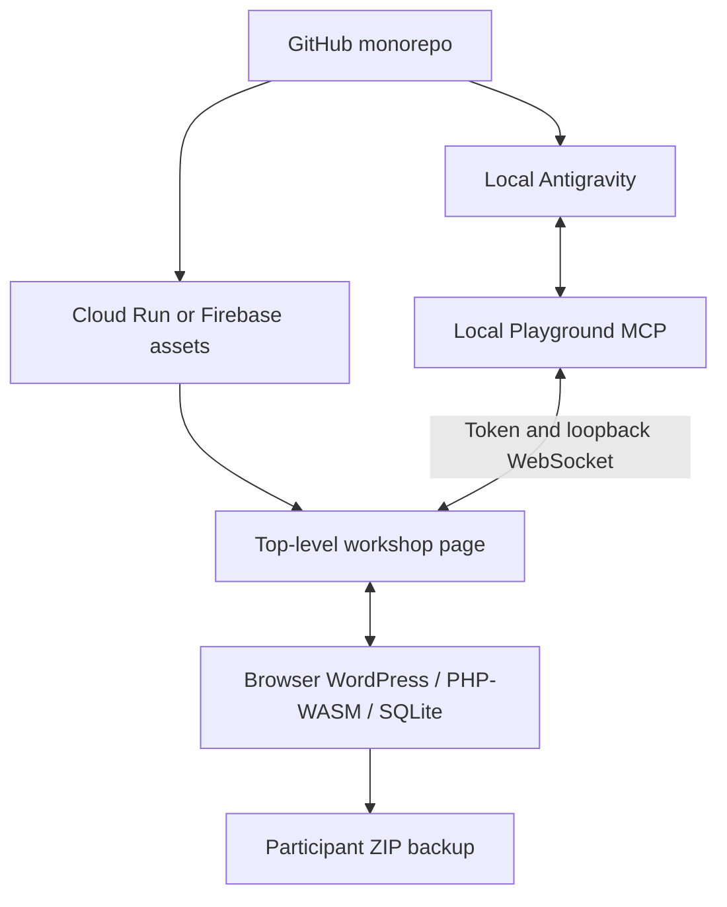

# WordPress Agent Workshop specification

- `Tease:` Give each attendee a real WordPress site that an agent can edit.
- `Lede:` Host a small browser app, run WordPress through WebAssembly, and connect Antigravity's local MCP process through the official Playground bridge.
- `Why it matters:` The workshop can demonstrate tools and skills with visible saved drafts, without a Docker/PHP/MySQL setup.
- `Go deeper:` Follow the [implementation plan](../plans/wordpress-playground-workshop-2026-10-24.md), [app guide](../../apps/wordpress-playground/README.md), and [verification record](../verification/wordpress-playground-workshop-2026-10-24.md).

Status: implementation handoff specification, October 24, 2026. Source publication is authorized. Cloud deployment, the exact cloud project, and a real Antigravity rehearsal are separate remaining steps.

## 1. Problem statement

The workshop needs an application that makes an agent's work inspectable. A participant should ask for an event announcement, see a WordPress draft appear, inspect its actual content, and learn how a skill packages a repeatable procedure. Docker installation, server credentials, and a shared mutable class blog add setup and recovery work that the exercise does not need.

The preferred presentation is a Google-hosted page created or finished in AI Studio. The agent operating WordPress runs in Antigravity on the attendee's laptop. A cloud agent's loopback address is a different machine, so those execution environments cannot be treated as interchangeable.

## 2. Solution

Ship one independent static workspace in the existing meetup monorepo. The page boots an embedded WordPress Playground, supplies the starter Blueprint, exposes backup and restore, and connects to the official local MCP bridge only after an explicit action. Antigravity discovers and operates the selected site through that bridge.

Provide two hosting paths: an isolated Node-compatible export for AI Studio Build and Cloud Run, and the repository's existing Firebase Hosting workflow. The Node process on Cloud Run serves static files only. The Node process on the laptop serves MCP over stdio and a loopback browser bridge. They have different jobs.

## 3. User stories

1. As an attendee, I can open the page and choose when to start WordPress, without creating a cloud account.
2. As an attendee, I see that this is my temporary sandbox and that a reload or reset discards unsaved work.
3. As an Antigravity user, I can start the pinned MCP process, obtain its launch URL, and connect only that local process to the visible site.
4. As a participant with more than one tab, I can identify the intended site by its distinct ID and name before the agent writes content.
5. As a workshop presenter, I can create a draft through MCP, read back the stored fields, and open that exact editor for inspection.
6. As an attendee, I can export my work and restore a supported Playground ZIP into a new sandbox.
7. As a presenter, I can reset to the same starter and compare the same task with and without the drafting skill, recording the actual outcome.
8. As a participant whose browser blocks the bridge or runtime, I receive a clear next step without being asked to disable browser protections.
9. As a maintainer, I can build the app in the monorepo and produce a standalone AI Studio project without changing other apps or the root default commands.
10. As the next coding agent, I can distinguish completed checks from proposed or blocked checks and continue from the recorded state.

## 4. Implementation decisions

### Decision status

**Requested:** WordPress/WASM, GitHub research and scaffold, MCP control through local Antigravity, AI Studio as the preferred hosting workflow, and Firebase as the fallback.

**Selected implementation defaults:** official Playground browser client and bridge, exact version 3.1.58, a small static TypeScript app, explicit start/connect actions, a temporary site with ZIP recovery, and a standalone export. These are implementation choices made for the requested scaffold.

**Unverified:** real Antigravity tool discovery and browser round trip, hosted HTTPS permission behavior, actual AI Studio import, and cross-browser compatibility. They remain acceptance work until recorded as observed.

### Runtime and site contract

The wrapper imports the official browser client and the official `startMcpBridge` export. It provides one site's list, client, rename, and persistence callbacks. Every tab receives a distinct random site ID. Renaming changes the visible name and notifies the bridge. The client is unavailable to bridge callbacks when the user's connection consent is inactive.

Use the canonical `https://playground.wordpress.net/remote.html` runtime. The wrapper's dependencies are pinned; the independently deployed runtime is not. Keep that distinction visible in operations documentation. The initial Blueprint contains only synthetic workshop content and uses an explicit supported WordPress/PHP combination. Avoid plugin/theme downloads unless a demonstrated workshop requirement needs them.

Do not display untrusted WordPress HTML in the trusted wrapper. The WordPress page stays in its iframe. Status and errors use text rendering. No application password, Gemini key, cloud credential, or user content belongs in the committed starter.

### Bridge contract

The local launcher validates an explicit HTTPS app origin, allowing HTTP only for localhost/127.0.0.1 development. It starts the installed pinned package directly with Node and keeps stdout reserved for MCP. It does not fetch arbitrary code at startup.

The official bridge owns its random port, loopback bind, origin checks, and per-process token. The wrapper accepts exactly one bounded numeric `mcp-port`; it has no arbitrary host parameter, network scanning, public relay, or remote-control endpoint. The hosted app and bridge run on the same attendee's machine from the browser's perspective.

Show **Connect** before any loopback request. The browser may ask for loopback/device permission. Permission denial is an ordinary recoverable state. Disconnect revokes wrapper access and stops its bridge handle, but cannot cancel an already executing WordPress operation. Since the upstream API exposes no disconnect event or registration acknowledgement, label connection status according to what was actually observed; an open WebSocket is not a verified post round trip.

### Content workflow

Discover the site, confirm its identity, read the brief/rules, create a `draft` through WordPress REST, then fetch the saved post by returned ID. Use normal WordPress block markup for editable content. Use PHP execution only for a concrete operation that REST cannot perform. Missing facts stay marked unknown; the agent must not invent dates, venues, registration links, or attribution.

Before retrying a timed-out write, query for the intended draft to avoid duplicates. A result requires the saved post ID, observed status, and inspection location. Do not infer success from fluent generated text.

### State, recovery, and reset

The site's active filesystem and database are disposable in-memory state. This is a documented exception to the repo's durability default because isolation and reset are core workshop behavior. Git and the Blueprint are authoritative for the starter; the participant's exported ZIP is authoritative for their retained work.

The browser-save MCP callback explicitly reports unsupported. A ZIP button exports WordPress data; a restore control imports a participant-selected supported archive and reconnects WordPress navigation/login. It must not report completion before the API succeeds. Reset requires confirmation and recreates the seed. An exported ZIP contains site data and should be kept by the participant, not committed to the public repo.

Review this design if attendee work needs autosave, shared editing, durable hosted content, or production use. At that point implement and test actual storage, rather than storing metadata and calling the site saved.

### Hosting and portability

Keep all application code in one workspace. The normal monorepo build stays on Bun and the single root lockfile. Node 24.18+ is an additional requirement only for the MCP lane and optional static server. The upstream package declares npm 11.16+ when using npm; the launcher itself requires no npx installation.

The standalone export copies an allowlist of app source and safe documentation, produces independent TypeScript/package configuration, and refuses to overwrite an existing export. It must not copy credentials, local MCP settings, `node_modules`, or participant exports. AI Studio imports an isolated project root; support for selecting a subdirectory in this monorepo is not assumed.

Cloud Run serves the static build on its supplied `PORT`, with no server database and zero minimum instances when deployed. Firebase serves the same static build using the repository's explicit project/site workflow. Preserve existing apps and sites. Billing, account connection, provisioning, and deployment require a named target and authority at that step.

## 5. Testing decisions

The central acceptance boundary is a real content workflow: boot the starter, connect MCP, create a uniquely identifiable draft, read back its exact title/content/status, and open that same post in WordPress. Run a real recovery check by exporting it and restoring into a fresh sandbox. Unit tests cannot replace either check.

Automated local checks cover strict port/origin validation, source types/build, no automatic bridge connection, visible failure paths, phone-width layout, static-server path containment, and safe standalone export. An optional real integration script exercises the official stdio MCP and actual browser runtime without pretending that it is an Antigravity integration test.

Hosted rehearsal must cover a fresh Chrome permission state, allow and deny, wrong origin, stopped/restarted bridge, two distinct tabs, and a top-level deployed URL. Firefox and Safari results are recorded separately; source inspection alone does not establish browser support. Current Chromium is the primary workshop target.

For the skill comparison, use fresh conversations and identical initial sites, model, tool access, brief, rules, and allowed external information. Change only skill context. Do not force or promise a weaker baseline result.

Report every acceptance criterion as passed, failed, blocked, or not exercised, with command/browser/version evidence. The app contract stays `scaffold` until its declared completion checks actually pass.

## 6. Out of scope

- A shared or production WordPress server, public MCP endpoint, or cloud agent controlling an attendee's laptop.
- A new custom bridge, broad CORS policy, disabled browser protections, public tunnel, or local certificate installation.
- WordPress MCP Adapter/Abilities plugins, WebMCP, or a Docker-based fallback.
- A new database, Firebase Auth, Gemini API calls, a paid cloud service provisioned automatically, or modifications to other meetup apps.
- Guaranteed offline operation or a fully frozen self-hosted WASM asset distribution.
- Installing Matt Pocock's complete skills collection or creating a parallel ticketing system.

## 7. Further notes

This structure adapts the current [Matt Pocock research](../research/matt-pocock-specs-and-handoffs-2026-10-24.md): synthesize decisions, preserve uncertainty, verify observable behavior, and keep implementation slices demonstrable. It does not claim to have run his skills or his evaluation workflow.

Primary technical evidence and version caveats are in the [Playground research](../research/wordpress-playground-workshop-2026-10-24.md) and [browser bridge review](../research/wordpress-playground-browser-bridge-2026-10-24.md). Repository-specific commands and paths belong in the app guide and handoff rather than defining the product contract here.
